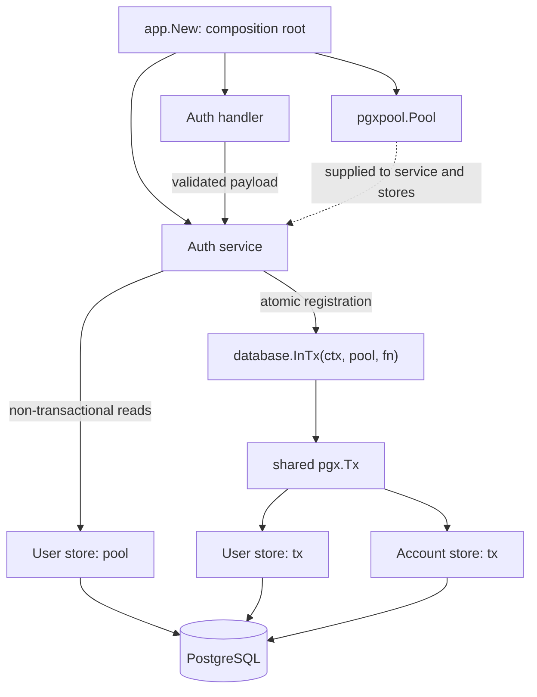

# Backend Architecture Guidelines

**Pattern:** Handler → Service → Store (Controller-Service-Repository)
**Stack:** Go, PostgreSQL, pgx; parameterized SQL, no ORM or query builder.

## 1. Layer Responsibilities

| Layer | Owns | Must not contain |
| --- | --- | --- |
| **Handler** | HTTP routing, decoding, payload validation, status codes, JSON responses | Business workflows, SQL, transactions |
| **Service** | Business rules, workflow orchestration, transaction boundaries | HTTP details, SQL |
| **Store** | Parameterized queries, row scanning, persistence error translation | Business workflows, HTTP details, transaction ownership |
| **Database platform** | Pool setup and transaction lifecycle through `database.InTx` | Domain rules, application queries |

### Handlers

- Decode and validate request payloads before calling a service.
- Translate domain errors into HTTP responses.
- Log unexpected errors and return a generic response without leaking internals.

### Services

- Enforce business rules and coordinate stores.
- Decide which operations must succeed or fail together.
- Use `database.InTx` with a pool for atomic workflows; construct participating stores with the callback's `pgx.Tx`.
- Keep expensive work that does not need a transaction, such as password hashing, outside it.
- Return safe domain models or DTOs; never expose password hashes.

### Stores

- Accept `database.DBTX`, which both `*pgxpool.Pool` and `pgx.Tx` satisfy.
- Execute queries through the supplied dependency. The same store works inside or outside a transaction.
- Translate recognized persistence errors into domain errors, such as `user.ErrEmailTaken` or `user.ErrNotFound`.
- Wrap unexpected errors with operation context using `%w`.
- Do not begin transactions or construct other stores.

## 2. Dependencies and Wiring

`internal/app/app.go` is the composition root. Wire dependencies explicitly with constructors; no IoC container is required.

- **Handlers** receive services and supporting infrastructure such as a logger.
- **Services** receive stores and collaborating services through consumer-defined interfaces. Construct pool-backed stores in `app.New`; additionally inject a pool when a service owns transactional workflows. Transaction-bound stores are constructed inside the transaction callback.
- **Stores** receive `database.DBTX`.
- Services may depend on other services for shared business logic, but dependencies must remain acyclic. Extract shared logic when needed.



## 3. Transaction Ownership

**The service owns the boundary; `database.InTx` manages the lifecycle.**

- `DBTX` exposes only `Exec`, `Query`, and `QueryRow`; it does not expose `Begin`.
- `InTx` accepts a `*pgxpool.Pool`, begins a transaction, and passes `pgx.Tx` to the callback.
- A nil callback error triggers commit. A callback error is returned and triggers deferred rollback.
- Deferred rollback also runs during panic unwinding and uses a context without request cancellation so cleanup can proceed.
- Begin and commit failures are returned with operation context.
- This helper does not support nested transactions. Pass the existing transaction to participating stores instead.
- Inside the callback, use transaction-backed stores for all participating writes. Using a pool-backed store would put those writes outside the transaction.

### Example: Registration

`AuthService.Register` checks email availability and hashes the password before starting the transaction. Inside it, `user.NewStore(tx).Create` inserts the user, then `account.NewStore(tx).Create` inserts credentials.

```mermaid
sequenceDiagram
    participant H as Auth handler
    participant S as Auth service
    participant U as User store
    participant T as database.InTx
    participant A as Account store
    participant DB as PostgreSQL

    H->>S: Register(ctx, payload)
    S->>U: FindByEmail (pool)
    U->>DB: SELECT user
    DB-->>U: Result
    U-->>S: User or error
    Note over S: Reject existing email or unexpected error; otherwise hash password
    S->>T: InTx(ctx, pool, callback)
    T->>DB: BEGIN
    T->>S: Run callback(tx)
    S->>U: Create (tx)
    U->>DB: INSERT user
    DB-->>U: User or error
    U-->>S: User or error
    opt User created successfully
        S->>A: Create (same tx)
        A->>DB: INSERT credentials
        DB-->>A: Account or error
        A-->>S: Account or error
    end
    S-->>T: Callback result
    alt Callback succeeds
        T->>DB: COMMIT
    else Callback fails
        T->>DB: ROLLBACK
    end
    T-->>S: Transaction result
    S-->>H: User or error
```

A credentials failure must roll back the user insert. The email pre-check is only an early response: the database unique constraint remains authoritative when registrations race.

## 4. Validation and Errors

| Layer | Validates | Failure handling |
| --- | --- | --- |
| **Handler** | JSON shape, required fields, lengths, basic formats | Return `400 Bad Request` |
| **Service** | Business rules, permissions, application state | Return domain errors |
| **Store / database** | Unique keys, foreign keys, not-null and other integrity constraints | Translate known violations; wrap unexpected failures |

Errors travel upward through normal Go returns, not exceptions:

1. The store translates recognized database failures into domain errors.
2. The service returns or wraps errors with `%w`, preserving `errors.Is` and `errors.As` behavior.
3. The handler maps domain errors to appropriate HTTP status codes, such as `409 Conflict` for an email already taken. Unexpected failures are logged and become a generic `500 Internal Server Error`.

Data flows upward as **database rows → store models → service results → handler JSON**. Keep sensitive persistence fields out of public responses.

## 5. Verification

The backend currently has no automated tests or shared test helpers. See the [backend checks](../README.md#checks) for compilation and static analysis commands. Runtime behavior, database constraints, and authentication flows require manual verification.
