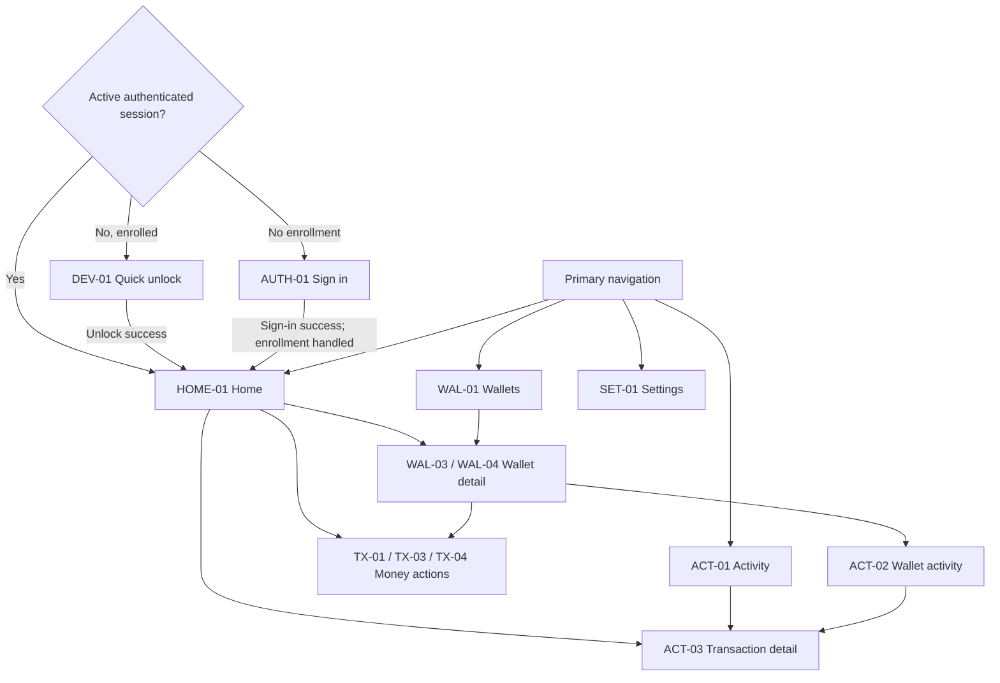
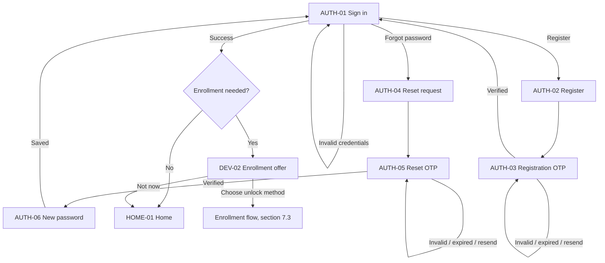
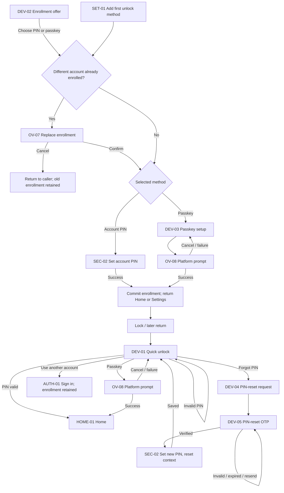
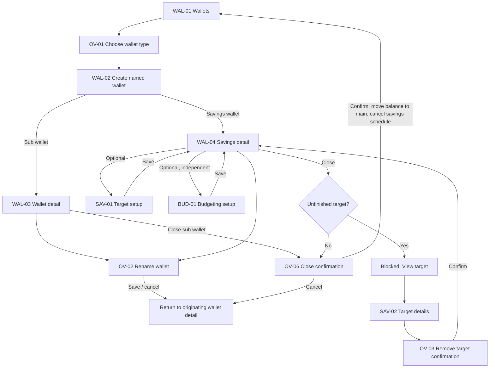
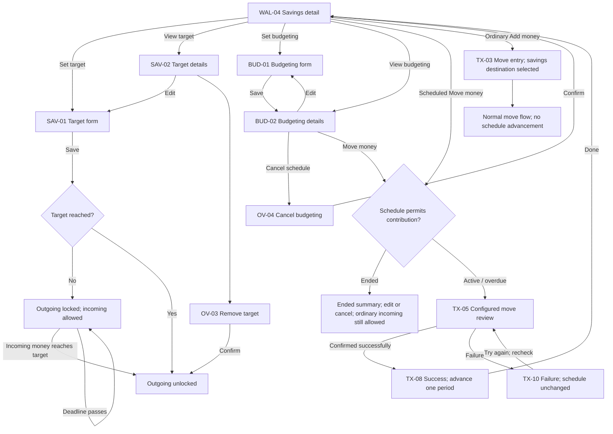
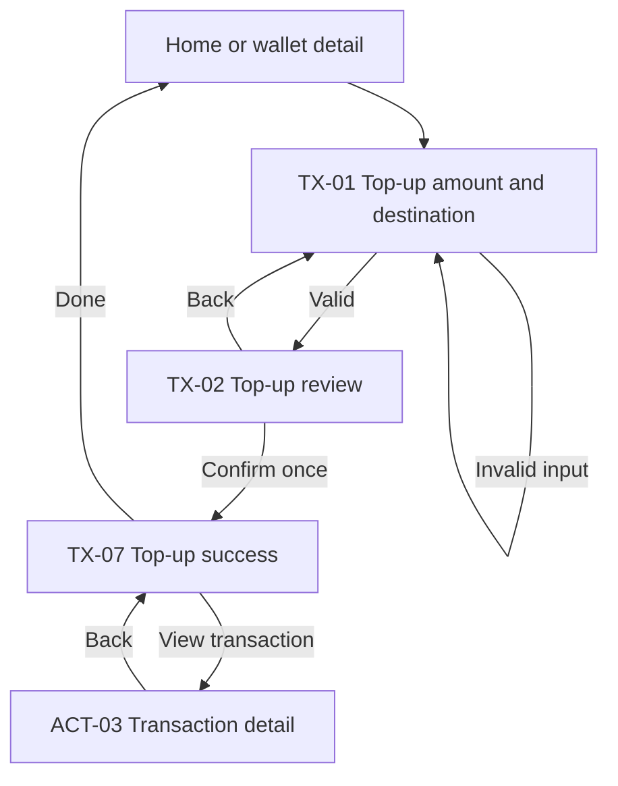
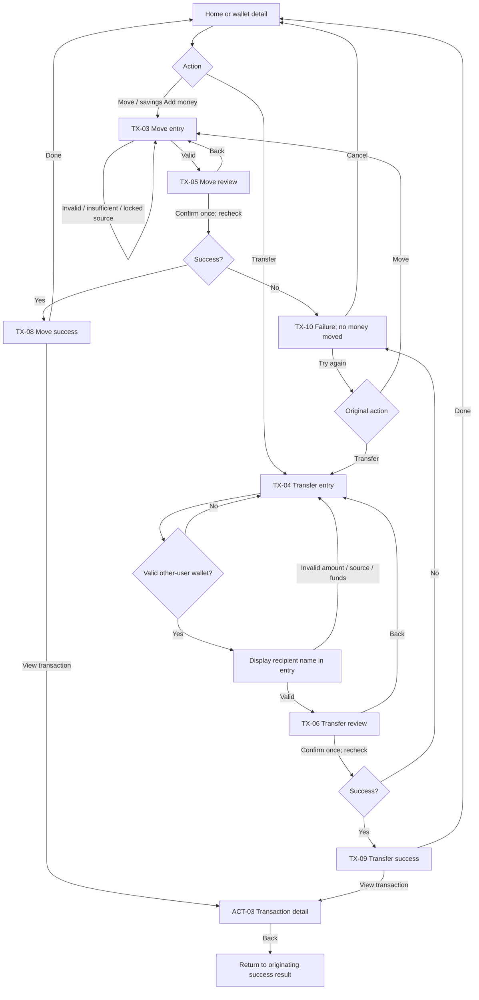
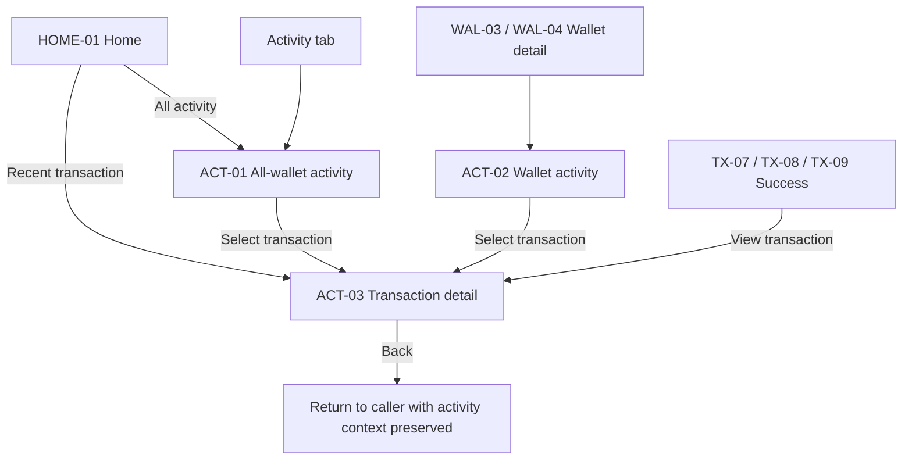
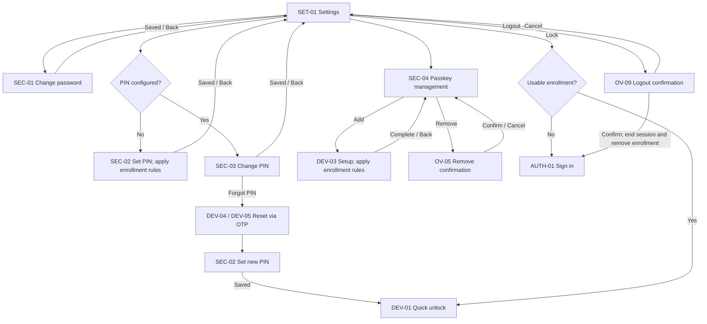

# Still Bank — Screen Inventory and Flow Map

## 1. Purpose and scope

This document maps the complete mobile-app-style MVP into screens, supporting surfaces, and user journeys. It is a design specification, not an implementation or backend contract.

### Sources and precedence

- [MVP feature list](mvp-list.md) defines feature scope and takes precedence where wallet and savings behavior differs from the earlier problem definition.
- [Problem and users](problem-and-users.md) defines user needs, product intent, and usability outcomes.
- The **Agreed design decisions** below record decisions made while preparing this inventory; they are not claims that the source documents already specify these details.

All money movement and account behavior are simulated. The UI should feel like a complete banking product without demo labels. IDR is the only currency. Desktop-specific layouts and all other MVP exclusions remain out of scope.

### Reading the inventory

- **Screen:** a navigable full-screen destination with its own task or context.
- **Overlay:** a sheet or dialog layered over a screen; not a primary destination.
- **Inline state:** feedback within an existing screen; not a separate screen.
- IDs are stable design references, not prescribed URL routes.
- Screens sharing a template retain separate IDs when their purpose or navigation differs.
- Persistent tabs belong to primary destinations. Focused forms, reviews, results, and security journeys use contextual back/close navigation rather than tabs that bypass the task.

### Design checklist — pen.dev

Last checked against [still-bank.pen](../still-bank.pen) on **2026-11-19**: **14 of 38 screen IDs** and **3 of 9 overlay IDs** have designs.

- **Checked `[x]`:** at least one populated design frame exists for this ID. Frame IDs below locate the design in pen.dev; related variants share the inventory ID in their frame names.
- **Unchecked `[ ]`:** no design frame was found for this ID during the last check.
- A checked item records design presence. Required states in section 6, navigation rules, visual review, and runtime verification remain separate checks; notes identify limited context coverage.
- After adding, replacing, or removing a screen or overlay design, update its checkbox, frame references, coverage notes, and the verification date/counts here. Inspect the canvas before marking it checked; a journey-map mention or reusable component alone does not count.

**Authentication — section 4.1**

- [x] `AUTH-01` Sign in — `pAMku` (empty); validation, submitting, and registration/password-reset confirmation variants also exist.
- [x] `AUTH-02` Register — `RLExB` (empty); validation and submitting variants also exist.
- [x] `AUTH-03` Verify registration email — `yTYcq` (waiting); invalid/expired code and resend variants also exist.
- [x] `AUTH-04` Request password reset — `ejWPg` (empty); invalid email and sending-code variants also exist.
- [x] `AUTH-05` Verify password-reset OTP — `sE8wz` (waiting); verification, expired-code, resend, and narrow-layout variants also exist.
- [x] `AUTH-06` Set new password — `h6TTFd` (empty); mismatch, saving, and editing/reveal variants also exist.

**Device enrollment and unlock — section 4.2**

- [x] `DEV-01` Quick unlock — `dxkab` (PIN and passkey), `qhDaX` (PIN only), `hJN3s` (passkey only); error, cancellation, unlocking, and reset-complete variants also exist.
- [x] `DEV-02` Enrollment offer — `pnkFT` (choose a method).
- [x] `DEV-03` Passkey setup — `hadka` (ready); unavailable, awaiting-platform, failed, and cancelled variants also exist.
- [x] `DEV-04` Request PIN reset — `OoXvY` (ready); sending-code and delivery-failure variants also exist.
- [x] `DEV-05` Verify PIN-reset OTP — `Aabev` (waiting); invalid/expired code, verification, resend, and narrow-layout variants also exist.

**Home and wallets — section 4.3**

- [x] `HOME-01` Home overview — `O8Rgfi` (populated), `I2fbM` (first visit, zero balances, main wallet only, empty activity), `D9JFa` (no sub wallets), `k1Qib` (no savings wallets), `M0eP4` (long wallet names and IDR amounts, 320 px). Existing wallets have individual flat Card / Surface instances in a bento arrangement: main spans two columns, other wallets one each, without category subsections. Each sub or savings wallet shows its type below its balance; multiple wallets of either type may exist. Absent wallets add no explanation or creation CTA. Activity is wrapped in its own flat card with its heading and View all outside. Narrow cards stack. Savings target details and outgoing-lock labels are omitted from Home and belong in wallet detail. Top up, Move, Transfer, and Others use 44 × 44 px icon buttons with centered 12 px labels beneath them and an 8 px gap across all five variants, matching the populated Home's action row `EPgw4`. Others is intentionally undecided; other onward destinations and accessible names are documented in node context, not implemented interactions.
- [x] `WAL-01` Wallet list — `y3dYdG` (populated), `Bxhs5` (first visit, zero balance, main wallet only), `uauO1` (no sub wallets), `q54Aw` (no savings wallets), `obNC4` (multiple sub/savings wallets, long names and IDR amounts, 320 px), `tBRgy` (closed-wallet return feedback), `CN67s` (balances hidden). The 390 px states use a two-column bento grid with 169 × 169 px wallet and Create wallet cards; the narrow long-content case uses 280 × 280 px cards. Main uses Primary, creation uses Secondary, and both sub and savings wallets use Card (white). A total-balance summary above the grid includes all open wallets and a 44 px eye toggle. Hiding masks the total and each wallet amount with `Rp ••••••`; names, types, icons, counts, and navigation remain visible. Showing restores the amounts. The final Create wallet card opens `OV-01`. The closure example moves Holiday fund’s Rp12.000.000 to main, producing Rp14.450.000 while the total stays Rp18.450.000; its target was removed beforehand and it had no budgeting schedule. Navigation and toggle behavior are documented in node context, not implemented interaction.
- [ ] `WAL-02` Create wallet.
- [ ] `WAL-03` Main/sub wallet detail.
- [ ] `WAL-04` Savings wallet detail.

**Savings targets and budgeting — section 4.4**

- [ ] `SAV-01` Create/edit target.
- [ ] `SAV-02` Target details.
- [ ] `BUD-01` Create/edit budgeting.
- [ ] `BUD-02` Budgeting details.

**Money movement — section 4.5**

- [ ] `TX-01` Top-up entry.
- [ ] `TX-02` Top-up review.
- [ ] `TX-03` Move entry.
- [ ] `TX-04` Transfer entry.
- [ ] `TX-05` Move review.
- [ ] `TX-06` Transfer review.
- [ ] `TX-07` Top-up success.
- [ ] `TX-08` Move success.
- [ ] `TX-09` Transfer success.
- [ ] `TX-10` Move/transfer failure.

**Activity — section 4.6**

- [ ] `ACT-01` All-wallet activity.
- [ ] `ACT-02` Wallet activity.
- [ ] `ACT-03` Transaction detail.

**Settings and security — section 4.7**

- [ ] `SET-01` Settings.
- [ ] `SEC-01` Change password.
- [x] `SEC-02` Set account PIN — `p7YBg` (enrollment), `GfzKs` (verified reset); mismatch, saving, and narrow-layout variants also exist. No dedicated Settings-context frame was found.
- [ ] `SEC-03` Change account PIN.
- [ ] `SEC-04` Passkey management.

**Overlays and platform surfaces — section 5**

- [x] `OV-01` Wallet-type sheet — `Dg4eL` (390 px), `xgYTu` (320 px), each over the revised bento Wallets screen. Connected descriptive choice rows offer Sub wallet or Savings wallet and lead directly to `WAL-02` with the type selected. No main-wallet option. Close/dismiss returns to unchanged `WAL-01` and restores focus to the Create wallet card. Modal focus containment, background inertness, dismissal, and focus restoration are implementation checks.
- [ ] `OV-02` Rename-wallet sheet.
- [ ] `OV-03` Remove-target confirmation.
- [ ] `OV-04` Cancel-budgeting confirmation.
- [ ] `OV-05` Remove-passkey confirmation.
- [ ] `OV-06` Close-wallet confirmation.
- [x] `OV-07` Replace-enrollment confirmation — `Q5EnzS`.
- [x] `OV-08` Platform passkey prompt — `WCKE6` (create), `qZYKY` (unlock). These illustrate the platform handoff; the real prompt is owned by the OS/browser.
- [ ] `OV-09` Logout confirmation.

## 2. Agreed design decisions

| Area | Decision |
| --- | --- |
| Deliverable | One document containing inventory and linked Mermaid flow maps. |
| Coverage | Entire MVP, including alternate, failure, empty, and blocked states. |
| Primary navigation | Home, Wallets, Activity, Settings. Top up, Move, and Transfer are contextual actions, not tabs. |
| Home balances | Show total balance and each wallet's balance, with persistent main/sub/savings type labels inside individual cards. Do not label total balance as available to spend. Main wallet is the everyday-spending reference, not the only spendable wallet. |
| Wallet creation | Name-only creation; savings target and budgeting are independent optional setup tasks offered after creating a savings wallet. |
| Wallets balance visibility | Show the sum of all open wallets, including savings, with a hide/show eye control. Hiding masks the total and individual wallet balances on this view; showing restores the amounts. Names, types, counts, and navigation remain visible. The total is not an available-to-spend claim. Persistence across other screens or sessions is unspecified. |
| Enrollment | After password sign-in, offer account PIN, passkey, or Not now. Add another method later in Settings. |
| Device/account switching | One enrolled account per device. Use another account preserves enrollment; replacing it requires explicit confirmation. An unenrolled session does not replace it. |
| Transaction structure | Separate Top up, Move, and Transfer entry forms; each leads to Review and Result. Contextual entry preselects the relevant wallet. |
| Savings contributions | Scheduled Move money uses the configured source/amount and advances the schedule on success. Ordinary Add money opens an incoming own-wallet move and does not advance it. |
| Authorization | Confirm on Review submits a transaction; no additional transaction PIN/passkey challenge. |
| Recovery | Verified registration returns to Sign in. Password recovery returns to Sign in. Forgotten-PIN recovery leads to Set new PIN, then Quick unlock. |
| Locked savings | Explain the restriction and offer View target. Exclude locked wallets from eligible source choices. Require explicit target removal before closing a wallet with an unfinished target. |
| Budgeting lifecycle | Active, Overdue, or Ended. Initial next contribution date is the setup date. Advance one period per successful scheduled contribution; preserve an ended schedule summary for editing/cancellation. |
| Transaction exits | Success offers View transaction and Done. Move/transfer failure offers Try again and Cancel. Retry retains editable inputs; failure changes no balances or schedule progress. |
| Activity representation | One global entry per own-wallet move, visible in both affected wallets' histories. Shared transaction-detail screen. |
| Destructive actions | Confirm wallet closure, target removal, schedule cancellation, passkey removal, enrollment replacement, and logout. Explain relevant consequences before confirmation. |

## 3. Navigation and entry rules

### Primary destinations

| Tab | Destination | Main purpose | Main onward paths |
| --- | --- | --- | --- |
| Home | `HOME-01` | Understand total, everyday, reserved, and savings money | Wallet details; Top up; Move; Transfer; recent transaction; Activity |
| Wallets | `WAL-01` | Organize all wallets | Wallet details; create sub/savings wallet |
| Activity | `ACT-01` | Review activity across wallets | Transaction detail |
| Settings | `SET-01` | Manage security and session | Password, PIN, passkey; Lock; Logout |

### Entry and return rules

- No active session and no enrollment: open `AUTH-01`.
- Locked enrolled account: open `DEV-01` with that account's available unlock methods.
- Successful sign-in: offer enrollment if needed, then open Home. Successful quick unlock opens Home.
- Back from a form returns to its originating screen without committing changes. Back from Review returns to the form with inputs retained.
- Cancelling a sheet/dialog leaves the underlying screen and data unchanged.
- Wallet-context Top up preselects that wallet as destination; Move/Transfer preselect it as source when eligible. Savings Add money preselects the savings wallet as destination.
- Result Done/Cancel returns to the transaction's originating screen. View transaction opens `ACT-03`; its back action returns to the result while that flow is active.
- Ordinary detail screens return to their caller. Activity retains its all-wallet or wallet-specific context.
- Lock retains enrollment and opens Quick unlock. Without enrollment, Lock returns to password Sign in rather than offering an unavailable quick unlock.
- Logout removes device enrollment and ends the session, returning to Sign in.

## 4. Screen inventory

### 4.1 Authentication

| ID | Screen / purpose | Entry points | Primary actions | Exits and rules |
| --- | --- | --- | --- | --- |
| `AUTH-01` | Sign in | First visit; logout; Use another account; verified registration; password recovery | Enter email/password; Sign in; Register; Forgot password | Success → enrollment offer or Home. Invalid credentials stay inline. Switching accounts does not itself remove enrollment. |
| `AUTH-02` | Register | Sign in | Enter full name, email, password; submit | → registration OTP. Validate fields inline; do not create an authenticated session here. |
| `AUTH-03` | Verify registration email | Registration | Enter OTP; resend; return to correct registration details | Success → Sign in with confirmation. Invalid/expired OTP stays here. |
| `AUTH-04` | Request password reset | Sign in | Enter account email; request OTP | → password-reset OTP; Back → Sign in. |
| `AUTH-05` | Verify password-reset OTP | Reset request | Enter OTP; resend | Success → new password. Invalid/expired OTP stays here. |
| `AUTH-06` | Set new password | Verified password-reset OTP | Enter and confirm new password; save | Success → Sign in with confirmation; no automatic sign-in. |

### 4.2 Device enrollment and unlock

| ID | Screen / purpose | Entry points | Primary actions | Exits and rules |
| --- | --- | --- | --- | --- |
| `DEV-01` | Quick unlock | Returning enrolled user; Lock; completed PIN reset | Unlock with account PIN or passkey; Forgot PIN when PIN exists; Use another account | Success → Home. Another account → Sign in, preserving enrollment. PIN failure stays inline; passkey failure/cancellation allows retry or another available method. |
| `DEV-02` | Enrollment offer | Successful password sign-in when enrollment is needed | Choose account PIN; choose passkey; Not now | PIN → `SEC-02`; passkey → `DEV-03`; skip → Home. Replacing another account's enrollment first requires `OV-07`. |
| `DEV-03` | Passkey setup | Enrollment offer; passkey settings | Start device-supported passkey creation | Launch platform prompt `OV-08`. Success → Home for onboarding or passkey settings for Settings entry; cancellation/failure retains retry/back options. Do not claim success without a successful simulated outcome. |
| `DEV-04` | Request PIN reset | Forgot PIN on Quick unlock | Request email OTP for enrolled account | → PIN-reset OTP. Back → Quick unlock. |
| `DEV-05` | Verify PIN-reset OTP | PIN-reset request | Enter OTP; resend | Success → `SEC-02` in reset context. Invalid/expired OTP stays here. |

The Still Bank account PIN and the device PIN are different credentials. Passkey prompts may use biometrics or the device PIN; Still Bank must not describe either as its account PIN.

### 4.3 Home and wallets

| ID | Screen / purpose | Entry points | Primary actions | Exits and rules |
| --- | --- | --- | --- | --- |
| `HOME-01` | Home overview | Sign-in/unlock completion; Home tab | View balances; open wallet; Top up; Move; Transfer; view recent activity | → wallet details, transaction entry, transaction detail, or Activity. Distinguish main/sub/savings balances and never treat total as wholly available spending money. |
| `WAL-01` | Wallet list | Wallets tab | View total and main/sub/savings balances; hide/show balances; create wallet | → wallet details or wallet-type sheet. Visibility toggles in place. Exactly one main wallet exists automatically; it is never user-created. |
| `WAL-02` | Create wallet | Wallet-type sheet | Enter name; create chosen sub/savings type | Success → new wallet detail. Savings detail offers optional target and budgeting setup independently. No target or schedule is mandatory. |
| `WAL-03` | Main/sub wallet detail | Home; wallet list; relevant balance context | View balance/number; Top up; Move; Transfer; wallet activity; rename; close sub wallet | → transaction forms, wallet history, rename/closure overlays. Main wallet has no Close action. |
| `WAL-04` | Savings wallet detail | Home; wallet list; savings creation | View balance/number, target progress, schedule; Add money; scheduled Move money; Top up; outgoing Move/Transfer; activity; manage wallet | → target/budgeting screens, transaction forms, overlays. Outgoing actions are blocked while a target is unfinished; incoming actions remain available. |

Wallet details display the unique wallet number. Names may change, including the main wallet's name. Group/category identity must remain clear after renaming.

### 4.4 Savings targets and budgeting

| ID | Screen / purpose | Entry points | Primary actions | Exits and rules |
| --- | --- | --- | --- | --- |
| `SAV-01` | Create/edit target | Savings detail without a target; target details | Enter target amount; optionally deadline; save | → savings detail or target detail according to caller. Show the outgoing-lock consequence before saving an unfinished target. |
| `SAV-02` | Target details | Savings detail; View target from a lock explanation | View amount, progress, optional deadline, and lock status; edit; remove | Edit → target form; remove → `OV-03`. Reached amount unlocks outgoing money; deadline alone never unlocks it. |
| `BUD-01` | Create/edit budgeting | Savings detail; budgeting detail | Set amount, main/sub source, daily/weekly/monthly period, finish date; save | → savings detail or budgeting detail according to caller. Creation sets initial next contribution date to setup date; editing exposes the current schedule context. |
| `BUD-02` | Budgeting details | Savings detail | View schedule, source, amount, next date, finish date, status; Move money; edit; cancel | Move money → `TX-05` with configured values; edit → budgeting form; cancel → `OV-04`. Ended schedules have no scheduled contribution action. |

#### Savings and schedule rules

- A savings wallet may have neither target nor budgeting, either one, or both.
- Target progress and budgeting status are independent. Reaching a target does not automatically cancel budgeting.
- Target states: no target, unfinished/outgoing locked, reached/outgoing unlocked. A passed deadline is progress context only.
- Budgeting states: no schedule, Active, Overdue, Ended. A schedule is Ended after its finish date, taking precedence over an overdue date.
- Savings detail shows the schedule description and its **Move money** action while the schedule permits contributions.
- Each successful scheduled contribution advances the next date by exactly one configured period, including early contributions. Overdue catch-up is one installment per confirmation, never a bulk deduction.
- Failure leaves the next date and all balances unchanged. Retry must not duplicate a successful contribution.
- Ordinary Add money, top-ups, and incoming transfers affect balance/target progress but do not advance budgeting.
- The same savings wallet may receive ordinary incoming money after budgeting ends.
- Closing a savings wallet cancels its schedule as part of closure, after any unfinished target has been explicitly removed.

### 4.5 Money movement

| ID | Screen / purpose | Entry points | Primary actions | Exits and rules |
| --- | --- | --- | --- | --- |
| `TX-01` | Top-up entry | Home; wallet detail | Enter amount; choose any open destination | → top-up review. No payment-method step. Target-locked savings remain eligible destinations. |
| `TX-02` | Top-up review | Valid top-up entry | Review amount/destination; Confirm; Back | Confirm → top-up success. Top-up has success only, not a simulated failure result. |
| `TX-03` | Move entry | Home; wallet detail; savings Add money | Choose eligible own source, different open destination, amount | → move review. Locked savings cannot be sources; they can be destinations. |
| `TX-04` | Transfer entry | Home; wallet detail | Choose eligible source; enter another user's wallet number; resolve recipient; enter amount | → transfer review only after recipient name is displayed. Invalid/unknown recipient and own-wallet destination stay inline; own-wallet moves use Move. |
| `TX-05` | Move review | Move entry; scheduled Move money | Review source, destination, amount and scheduled context if applicable; Confirm; Back | → move success/failure. Scheduled source/amount come from budgeting; Back returns to its initiating savings context. Ordinary Back returns to editable entry. |
| `TX-06` | Transfer review | Valid transfer entry | Review source, recipient name/wallet number, amount, zero fee; Confirm; Back | → transfer success/failure. Recheck eligibility and funds before applying changes. |
| `TX-07` | Top-up success | Confirmed top-up | View transaction; Done | → transaction detail or origin. Show credited wallet and amount. |
| `TX-08` | Move success | Confirmed move, including scheduled contribution | View transaction; Done | → transaction detail or origin. Show both wallet effects. Advance schedule only for a scheduled contribution. |
| `TX-09` | Transfer success | Confirmed transfer | View transaction; Done | → transaction detail or origin. Show recipient and debit outcome. |
| `TX-10` | Move/transfer failure | Failed confirmed move/transfer | Explain no money moved; Try again; Cancel | Ordinary retry → entry with inputs retained. Scheduled retry → configured review after eligibility is checked. Cancel → origin. No balance or schedule change. |

#### Shared transaction rules

- Validate required selections, a positive valid IDR amount, eligible open wallets, and sufficient source funds.
- Explain insufficient funds and locked-source restrictions before confirmation when known. If eligibility changes or failure occurs at confirmation, show a failure result for Move/Transfer.
- Own-wallet moves require different source and destination wallets. Recipient transfers use another Still Bank user's wallet number, not an external bank identifier.
- Main, sub, and savings wallets may receive transfers. Transfer fees are zero.
- Review confirmation is the transaction authorization step; do not add PIN/passkey authorization screens.
- Show a submitting state that prevents repeated confirmation. Show success only after the simulated operation completes.
- Own-wallet moves preserve total balance; top-ups increase it; outgoing transfers reduce it.

### 4.6 Activity

| ID | Screen / purpose | Entry points | Primary actions | Exits and rules |
| --- | --- | --- | --- | --- |
| `ACT-01` | All-wallet activity | Activity tab; Home activity link | Browse transactions; open one | → shared transaction detail. Show each own-wallet move once and distinguish it from another-user transfer. |
| `ACT-02` | Wallet activity | Any wallet detail | Browse transactions affecting that wallet; open one | → shared transaction detail. The same own-wallet move appears in both affected wallet histories. |
| `ACT-03` | Transaction detail | Global/wallet activity; recent activity; success result | Inspect type, outcome, amount, date/time, transaction reference, participants, wallet balance effects | Back → caller. Show both own-wallet effects for a move; show the user's affected wallet and recipient for an outgoing transfer. |

Failure results do not imply a new posted balance-affecting activity item. Completed transactions remain understandable even if a wallet is later renamed or closed; the detail must preserve enough identifying context to explain the original movement.

### 4.7 Settings and security

| ID | Screen / purpose | Entry points | Primary actions | Exits and rules |
| --- | --- | --- | --- | --- |
| `SET-01` | Settings | Settings tab | Change password; manage account PIN/passkey; Lock; Logout | → security screens; Lock → Quick unlock if enrolled, otherwise Sign in; Logout → confirmation. No profile editor or device list. |
| `SEC-01` | Change password | Settings | Enter current/new password and confirmation; save | Success → Settings with confirmation. Errors stay inline. Forgotten-password recovery remains a separate signed-out journey. |
| `SEC-02` | Set account PIN | Enrollment offer; Settings when no PIN; verified PIN reset | Enter and confirm new account PIN | Enrollment success → Home; Settings success → Settings; reset success → Quick unlock. Enrollment replacement requires confirmation first. |
| `SEC-03` | Change account PIN | Settings when PIN exists | Verify current PIN; enter/confirm new PIN; save; Forgot PIN | Success → Settings. Forgot PIN → email OTP reset flow, which ends at Quick unlock. |
| `SEC-04` | Passkey management | Settings | View configured/unconfigured state; add passkey; remove registered passkey | Add → passkey setup; remove → `OV-05`. Keep password sign-in available even if no quick-unlock method remains. |

When an unenrolled signed-in account adds its first unlock method through Settings, apply the same enrollment/replacement rules as onboarding. Removing the final quick-unlock method must not leave a dead-end unlock screen; the account can still sign in using email/password.

## 5. Overlays and platform surfaces

| ID | Surface | Entry / actions | Outcome and guardrails |
| --- | --- | --- | --- |
| `OV-01` | Wallet-type sheet | Wallet list → choose Sub wallet or Savings wallet | → wallet creation with type selected. Main wallet is not an option. |
| `OV-02` | Rename-wallet sheet | Any wallet detail → edit name, Save/Cancel | Save updates name and returns to detail; invalid input stays in sheet. |
| `OV-03` | Remove-target confirmation | Target details → Remove/Cancel | Explain outgoing money will unlock. Confirm removes target only; budgeting remains unchanged. |
| `OV-04` | Cancel-budgeting confirmation | Budgeting details → Cancel schedule/Keep schedule | Confirm removes schedule without moving money or removing target. |
| `OV-05` | Remove-passkey confirmation | Passkey settings → Remove/Cancel | Explain remaining sign-in/unlock options; remove only the registered passkey, not another available method. |
| `OV-06` | Close-wallet confirmation | Eligible sub/savings detail → Close/Cancel | Show remaining balance moving to main; savings schedule cancellation if relevant. Confirm closes wallet and returns to wallet list with feedback. Main wallet cannot enter this flow. |
| `OV-07` | Replace-enrollment confirmation | Enroll another account → Replace/Cancel | Explain old account loses quick unlock on this device. Complete replacement only when new enrollment succeeds; cancelling/failing setup preserves old enrollment. |
| `OV-08` | Platform passkey prompt | Passkey setup/unlock → device-supported verification | Platform success/failure/cancel returns to invoking flow. Not a custom Still Bank biometrics screen. |
| `OV-09` | Logout confirmation | Settings → Logout/Cancel | Explain device enrollment is removed and email/password will be required next time. Confirm → Sign in. |

A close request on a savings wallet with an unfinished target shows a blocked explanation with **View target**, not `OV-06`. Removing the target is a separate confirmed operation; it is never silently bundled into closure.

## 6. Inline and transient states

These are variants of inventory screens, not additional full screens.

| Context | Required states / recovery |
| --- | --- |
| Authentication forms | Empty; editing; invalid/missing values; submitting; rejected credentials; retry. Preserve appropriate non-secret context. |
| OTP screens | Waiting for code; incomplete/invalid/expired code; resend pending/confirmation; verified. Retry/resend must not imply verification succeeded. |
| PIN setup/change | Entry; confirmation mismatch; invalid current PIN; saving; saved. Never conflate account PIN with device PIN. |
| Passkey | Unavailable device support; awaiting platform prompt; cancelled; failed; configured; removed. Offer password sign-in or another configured method when unlocking fails. |
| Home/wallets | Initial zero balances; main wallet only; no sub wallets; no savings wallets; populated wallets. Main wallet always exists. |
| Wallets balance visibility | Visible and hidden total/individual balances; Hide balances and Show balances action labels. Use a fixed-length mask and keep hidden numeric values out of accessible text. Opening/dismissing the type sheet preserves the calling view's visibility state. |
| Wallet details | No activity; zero balance; renamed; closed-wallet return feedback; eligible/blocked outgoing actions. |
| Target | No target; unfinished; reached; deadline passed while unfinished; removed. Clearly explain why outgoing money remains locked. |
| Budgeting | No schedule; Active; Overdue; Ended; insufficient source funds; unavailable source requiring schedule edit; contribution pending/success/failure. No automatic deduction. |
| Transaction entry | No eligible source; invalid amount; source/destination conflict; insufficient funds; unknown/invalid recipient; recipient resolved; source locked/unavailable. Provide a corrective path instead of a dead end. |
| Review/result | Submitting with repeated submission prevented; success; move/transfer failure with unchanged-balance message. Top-up has no failure-result variant. |
| Activity | Empty global history; empty wallet history; populated list; detail. A zero-activity state explains where completed activity will appear. |
| Settings | No enrolled unlock method; PIN only; passkey only; both configured; successful change feedback. |

## 7. Flow maps

Diagram node labels reference the screen and overlay IDs above. Descriptive decision nodes and inline feedback are not extra screens.

### 7.1 Navigation shell

### 7.2 Registration, sign-in, and password recovery

### 7.3 Enrollment, quick unlock, and account switching

Enrollment is not replaced merely by confirming `OV-07`: commit replacement only after successful setup. For an existing enrolled account, adding another unlock method does not replace that account's other method.

### 7.4 Wallet creation, renaming, and closure

The main wallet supports renaming but never closure. Closed wallets are removed from open-wallet destination/source choices; historical transaction context remains available.

### 7.5 Savings target and budgeting journeys

### 7.6 Top-up

All open wallet types, including target-locked savings, are eligible top-up destinations. There is no payment-method step or top-up failure result.

### 7.7 Own-wallet moves and recipient transfers

This diagram covers ordinary moves. Scheduled contributions enter move review directly and retry there with the configured values, as shown in section 7.5.

### 7.8 Activity and balance understanding

### 7.9 Settings, lock, and logout

## 8. MVP coverage and usability traceability

| Source feature area | Inventory coverage | Flow maps |
| --- | --- | --- |
| Authentication | `AUTH-01`–`AUTH-06`, `SEC-01` | 7.2, 7.9 |
| Device enrollment and unlock | `DEV-01`–`DEV-05`, `SEC-02`–`SEC-04`, `OV-05`, `OV-07`–`OV-09` | 7.3, 7.9 |
| Wallet management | `WAL-01`–`WAL-04`, `OV-01`, `OV-02`, `OV-06` | 7.4 |
| Savings targets | `SAV-01`, `SAV-02`, `OV-03`, savings inline states | 7.5 |
| Scheduled budgeting | `BUD-01`, `BUD-02`, `TX-05`, `TX-08`, `TX-10`, `OV-04` | 7.5 |
| Top-up | `TX-01`, `TX-02`, `TX-07` | 7.6 |
| Move and transfer money | `TX-03`–`TX-06`, `TX-08`–`TX-10` | 7.7 |
| Balances and activity | `HOME-01`, wallet details, `ACT-01`–`ACT-03` | 7.1, 7.8 |
| Settings and currency | `SET-01`, `SEC-01`–`SEC-04`; IDR throughout | 7.9 |

| User outcome | Design checkpoints |
| --- | --- |
| Understand available money | Home separates total from main/sub/savings balances; wallet details show lock status rather than implying all savings are unavailable. |
| Organize money | Create a named wallet, then move money into it through entry, review, and a clear result. |
| Save toward a goal | Optional target creation, visible progress, explicit lock explanation, manual contributions, independent budgeting. |
| Transfer confidently | Resolve recipient before review; show amount and zero fee; prevent duplicate confirmation; distinguish success from unchanged-balance failure. |
| Understand activity | Shared detail explains wallet effects; own moves appear once globally and in both relevant wallet histories. |

## 9. Boundaries for later design work

This inventory does not prescribe pixel layouts, visual styling, URL routes, component APIs, PIN length, OTP expiration/resend timing, or low-level calendar arithmetic such as month-end scheduling. These implementation and detailed interaction choices must preserve the journeys and rules above rather than introduce new product scope.

Do not add profile editing, notification centers, device-management lists, automatic deductions, saved recipients, scheduled transfers, external bank transfers, payment methods, cards, withdrawals, bill/QR payments, or extra financial products. Do not introduce a separate PIN/passkey transaction-authorization journey.
